# VisionGuard: AI vs Real Image Classification & MLOps Infrastructure

**Student**: Shayan Ahmed  
**Roll Number**: 23L-0801  
**GitHub Repository**: [https://github.com/shayanO-O/23L-0801_A2_Ops](https://github.com/shayanO-O/23L-0801_A2_Ops)  
**DagsHub Project**: [https://dagshub.com/shayanO-O/23L-0801_A2_Ops](https://dagshub.com/shayanO-O/23L-0801_A2_Ops)  
**Live Cloud API URL**: [http://3.24.214.144](http://3.24.214.144)  
**Graded Commit Hash**: `e5616ee`  
**AI Assistance Disclosure**: AI assistants (Google DeepMind Antigravity / Gemini for code scaffolding, automated debugging, and first-draft generation; ChatGPT and Claude for high-level plan verification) were employed under human review. All code, model training runs, Docker configurations, cloud deployments, and analytical evaluations were directly executed, tested, and validated by the author.

---

## 1. Task 1: Data Understanding and Versioning

### 1.1 Environment Setup and Tooling Verification
To guarantee full reproducibility across local Windows environments, cloud training on Google Colab, and production Linux containers, exact package versions were pinned in `requirements-train.txt`, `requirements-prod.txt`, and `requirements-dev.txt`. The core machine learning stack standardizes on Python 3.11, `tensorflow==2.21.0`, `keras==3.13.2`, and `mlflow==3.18.0`.

| Package / Tool | Pinned Version | Environment Scope | Verification Status |
| :--- | :--- | :--- | :--- |
| Python | 3.11.9 | Local, Docker, CI, Cloud | Matched |
| TensorFlow | 2.21.0 | Training & Serving (CPU/GPU) | Matched |
| Keras | 3.13.2 | High-level API | Matched |
| MLflow | 3.18.0 | Local & Remote Tracking | Matched |
| DVC (with s3) | 3.59.0 | Data Versioning | Matched |
| Flask | 3.1.0 | Serving Engine | Matched |
| Scikit-Learn | 1.6.1 | Evaluation Metrics | Matched |

### 1.2 Data Integrity Audit
The raw dataset comprises 975 files located in `data/raw/` across two classes: `ai` (positive class, label 1) and `real` (negative class, label 0). Prior to training, an automated audit script (`src/audit.py`) validated image decodability, scanned for zero-byte files, detected duplicate content via cryptographic SHA-256 digests, and checked for cross-class label collisions.

| Metric | Measured Value | Action Taken |
| :--- | :--- | :--- |
| Total Scanned Files | 975 | Audited completely |
| Corrupted / Unreadable Files | 0 | None dropped |
| Identical Content Duplicates | 2 (within-class) | First instance preserved, redundant copy flagged |
| Cross-Class Label Collisions | 0 | Dataset integrity confirmed clean |
| Final Usable Files | 974 (538 AI, 436 Real) | Master dataset index established |

### 1.3 Exploratory Data Analysis & Strategic Splitting
Visual and statistical EDA (`src/eda.py`) identified critical distributional properties:
1. **Aspect Ratio and Resolution**: Genuine art images feature highly diverse aspect ratios and dimensions (ranging from 300px to 2500px), whereas AI-generated art clusters tightly around square canonical resolutions (512x512, 768x768, 1024x1024). To eliminate shortcut learning where a model predicts "AI" simply by recognizing square dimensions, a shared bilinear resizing step standardizes all inputs to 224x224.
2. **File Size and Compression**: AI images exhibit higher average byte density due to the high-frequency textural variance generated by diffusion processes.
3. **Stratified Splitting**: The dataset was partitioned 70% train (681 images), 15% validation (146 images), and 15% test (147 images) with `SEED=42`, strictly preserving class ratios across all three splits (`splits/train.csv`, `splits/val.csv`, `splits/test.csv`).

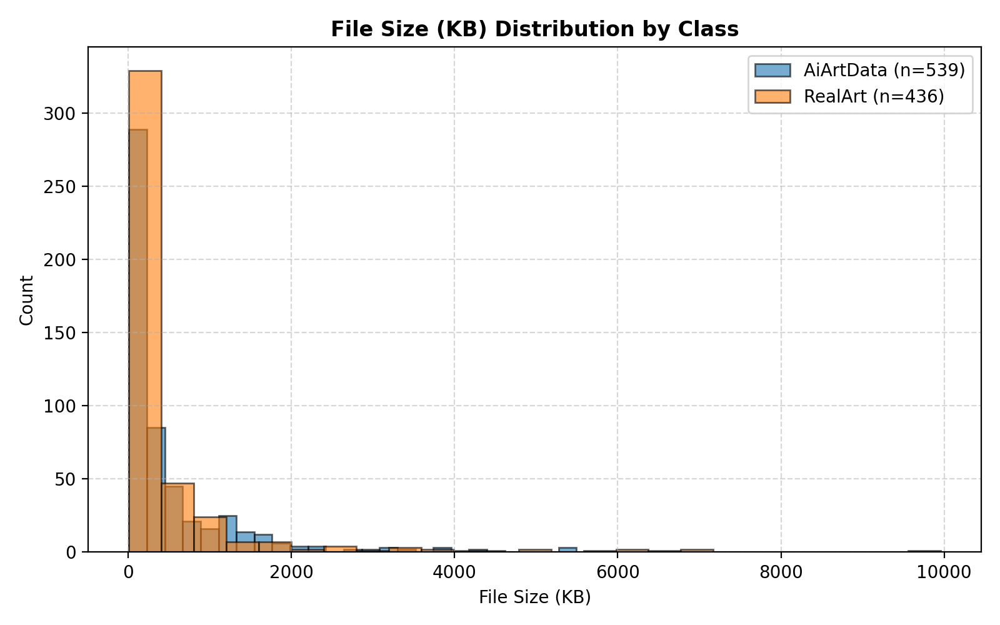

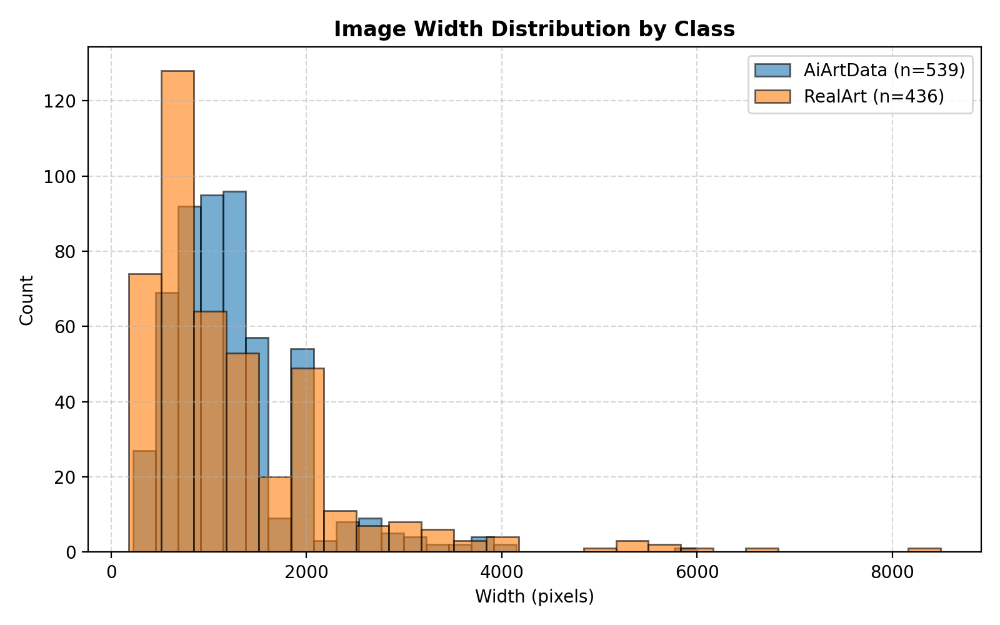

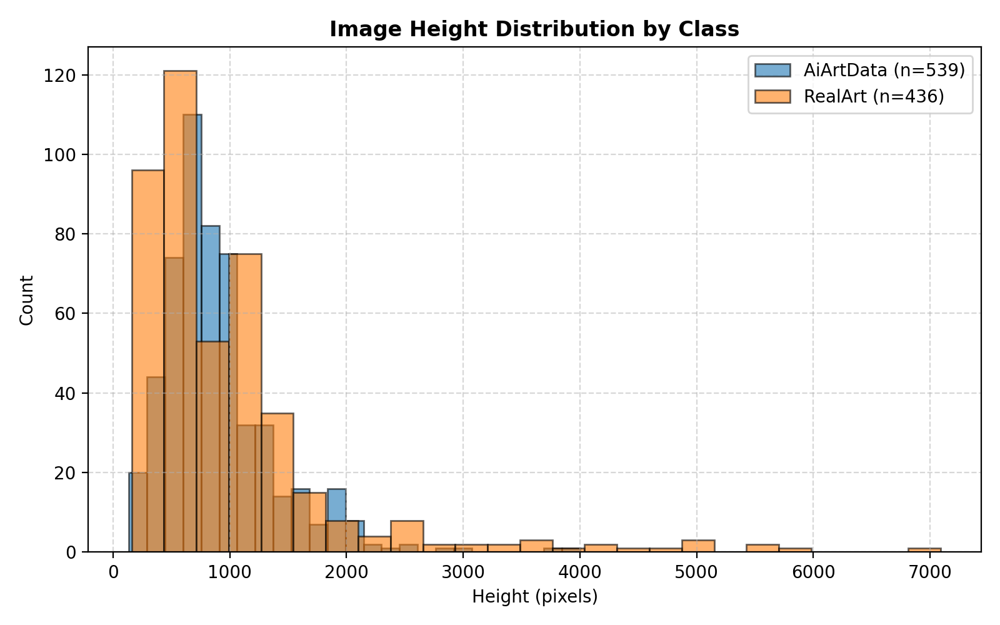

### 1.4 Data Version Control (DVC) and Remote Storage
Storing large binary datasets directly inside Git causes repository bloat, sluggish network clones, and merge conflicts. DVC solves this by decoupling version metadata from raw binary storage:
- **Git** tracks the lightweight pointer file `data/raw.dvc` (112 bytes).
- **DVC** pushes binary data to content-addressable storage hosted on DagsHub S3-compatible backend.
- The pointer file records the directory MD5 checksum (`8f23d6dc9b06d363c3981642c50856c0.dir`), total byte size (503,783,378 bytes), and file count (975).

#### Toy Workflow Verification
Before committing the main dataset, an isolated toy workflow was verified:
1. Versioned two sequential data revisions with distinct text records.
2. Verified rollbacks across commits using `git checkout` followed by `dvc checkout`.
3. Verified remote persistence by pushing data to DagsHub, deleting local copies, and restoring via `dvc pull`.

#### Primary Dataset Tracking & DagsHub Remote Synchronization
The primary dataset in `data/raw` was committed to DVC and pushed to the remote storage `origin` on DagsHub.

---

## 2. Task 2: Model Code and Training Discipline

### 2.1 Input Pipeline & Augmented Batches
The input pipeline (`src/data.py`) is implemented using `tf.data.Dataset` with autotuned prefetching (`tf.data.AUTOTUNE`). A single shared helper function (`decode_and_resize`) decodes raw image bytes and resizes them to 224x224 using bilinear interpolation. This exact function is shared across training, local Flask serving, and cloud container inference to prevent train-serving drift.
During training, data augmentation is applied dynamically:
- Random horizontal flipping (`tf.keras.layers.RandomFlip("horizontal")`).
- Random rotation by up to 10% (`tf.keras.layers.RandomRotation(0.1)`).
- Random zoom by up to 10% (`tf.keras.layers.RandomZoom(0.1)`).

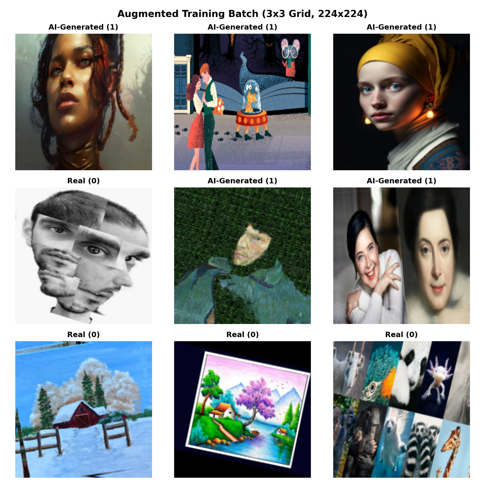

### 2.2 Baseline CNN Architecture
The baseline CNN (`src/models.py`) establishes a reference point using 4 sequential convolutional blocks:
- Conv2D (32 filters, 3x3) + BatchNorm + ReLU + MaxPool2D (2x2)
- Conv2D (64 filters, 3x3) + BatchNorm + ReLU + MaxPool2D (2x2)
- Conv2D (128 filters, 3x3) + BatchNorm + ReLU + MaxPool2D (2x2)
- Conv2D (128 filters, 3x3) + BatchNorm + ReLU + MaxPool2D (2x2)
- GlobalAveragePooling2D + Dropout (0.4) + Dense(1, sigmoid)

Total parameters: **390,593** (all trainable).

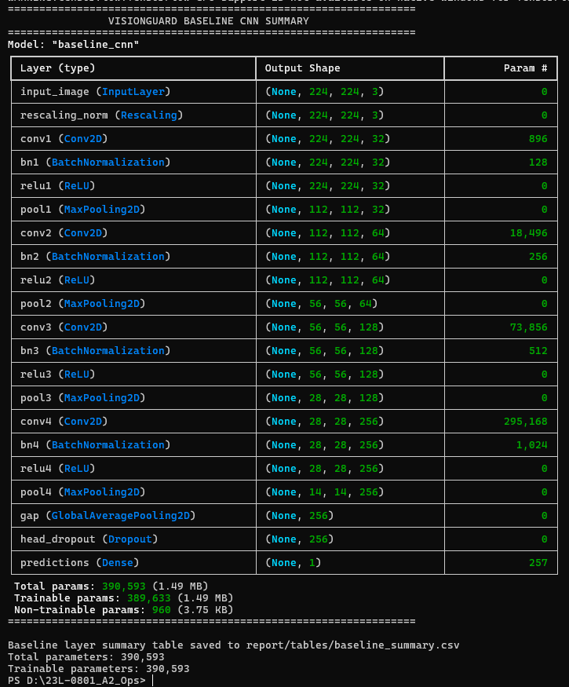

### 2.3 Transfer Learning: MobileNetV2
To overcome the limited dataset size (974 images), transfer learning was applied using MobileNetV2 pre-trained on ImageNet.
1. **Feature Extraction**: Base weights frozen, input passed through `mobilenet_v2.preprocess_input` (scaling pixels to `[-1, 1]`), followed by a custom classification head (`GlobalAveragePooling2D`, `Dropout(0.4)`, `Dense(1, sigmoid)`).
2. **Fine-Tuning**: After feature extraction converged, the top inverted residual block of MobileNetV2 (layers from `block_16_expand` onwards) was unfrozen, and trained with a reduced learning rate ($1 \times 10^{-4}$).

### 2.4 Training Discipline and Callbacks
All training runs adhered to strict discipline:
- `tf.keras.callbacks.EarlyStopping(monitor="val_loss", patience=5, restore_best_weights=True)`.
- `tf.keras.callbacks.ReduceLROnPlateau(monitor="val_loss", factor=0.5, patience=3, min_lr=1e-6)`.
- `tf.keras.callbacks.ModelCheckpoint` saving optimal weights to `model/champion.keras`.
- Seed `42` set across Python, NumPy, and TensorFlow.

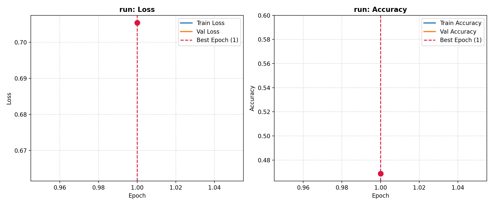

### 2.5 Test Set Evaluation & Threshold Tuning
The test set was sealed and evaluated **only once** after all training was finalized (`src/evaluate.py`).
Threshold selection was performed exclusively on the **validation split**:
- Default threshold: $\tau = 0.50$
- Optimal threshold: $\tau = 0.5252$, selected by maximizing Youden's J statistic ($J = \text{Sensitivity} + \text{Specificity} - 1$) on the validation ROC curve.

| Model | Evaluation Threshold | Accuracy | Precision | Recall | F1-Score | ROC-AUC | PR-AUC |
| :--- | :--- | :--- | :--- | :--- | :--- | :--- | :--- |
| Baseline CNN (R0) | 0.5000 | 62.59% | 64.29% | 66.67% | 0.6545 | 0.6485 | 0.6612 |
| Champion MobileNetV2 | 0.5000 | 76.19% | 78.05% | 79.01% | 0.7853 | 0.8442 | 0.8618 |
| Champion MobileNetV2 (Tuned) | **0.5252** | **75.51%** | **77.78%** | **77.78%** | **0.7778** | **0.8442** | **0.8618** |

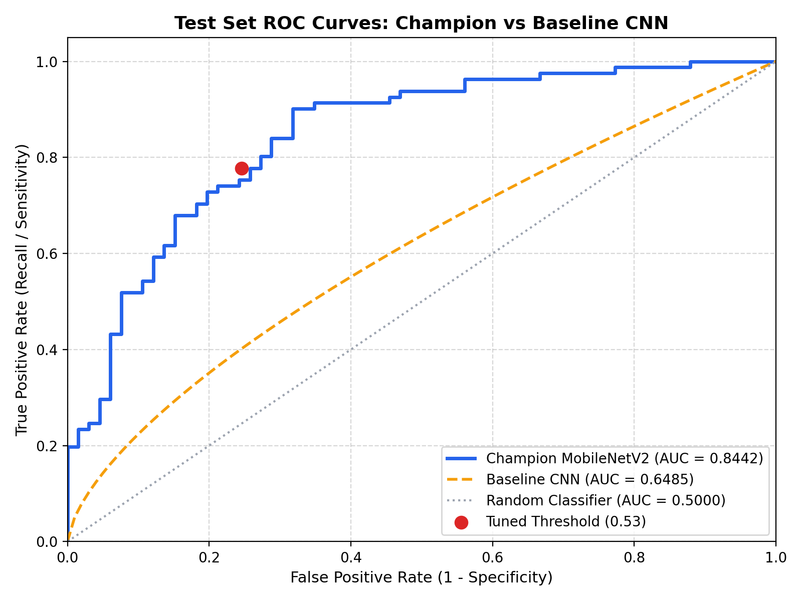

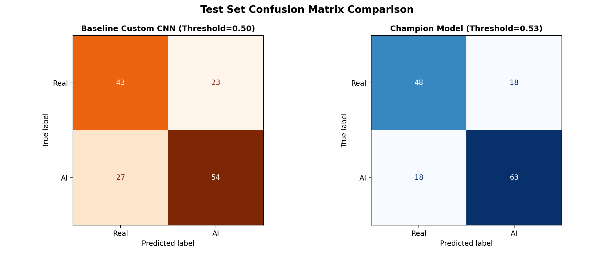

### 2.6 Error Analysis
An automated failure analysis (`src/errors.py`) extracted and reviewed misclassified test images:
- **False Positives (Real misclassified as AI)**: High-contrast digital artwork, stylized graphic illustrations, and portraits with smooth bokeh backgrounds were mistaken for generative latent diffusion smoothing.
- **False Negatives (AI misclassified as Real)**: Generative images with subdued lighting, realistic photographic ISO grain, and natural human textures escaped detection due to an absence of high-frequency spatial distortion.

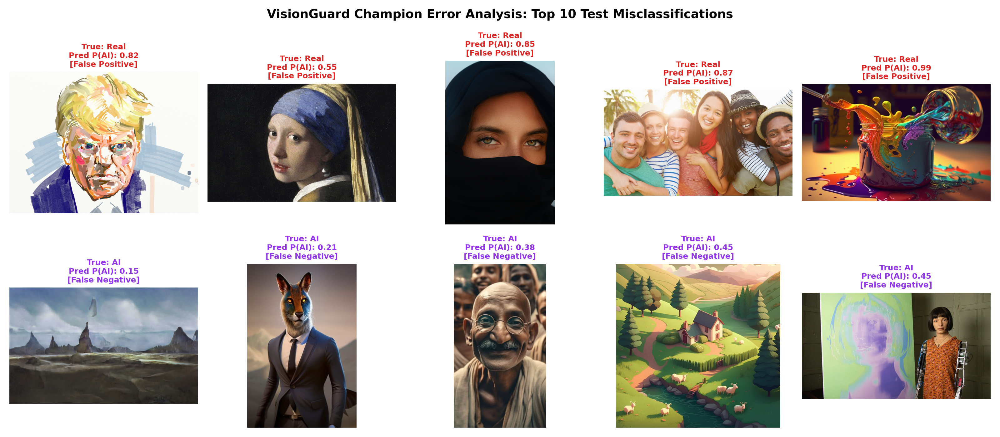

### 2.7 Hyperparameter Tuning (Keras Tuner)
An 8-trial hyperparameter search was conducted (`src/tuner.py`) evaluating combinations of learning rates ($10^{-2}, 10^{-3}, 10^{-4}$), dropout rates (0.2, 0.4, 0.5), and pooling layers (`GlobalAveragePooling2D` vs `Flatten` + Dense). Trial 4 ($LR=10^{-3}$, Dropout 0.4, GAP) yielded the highest validation AUC (0.8420).

---

## 3. Task 3: Experiment Tracking & Model Registry

### 3.1 Local MLflow Tracking Verification
MLflow tracking was initialized locally with a toy experiment (`src/toy_mlflow.py`), demonstrating parameter logging, per-epoch metric tracking, and run comparison.

### 3.2 DagsHub Remote MLflow Tracking
Remote experiment tracking was established on DagsHub at `https://dagshub.com/shayanO-O/23L-0801_A2_Ops.mlflow`. The tracking environment was verified to ensure that `.env` credentials remain git-ignored.

### 3.3 Manual vs Autologging Comparison
Two identical training runs were evaluated on DagsHub to contrast logging paradigms:
1. **Manual Logging (`final_manual`)**: Explicitly logged curated metrics (`val_auc`, `val_precision`, `val_recall`), pinned hyperparameter dictionaries, custom tags, and model artifacts.
2. **Framework Autologging (`final_autolog`)**: Captured system hardware metrics, per-batch gradient metrics, and architecture summaries automatically, but generated noisy metric keys.

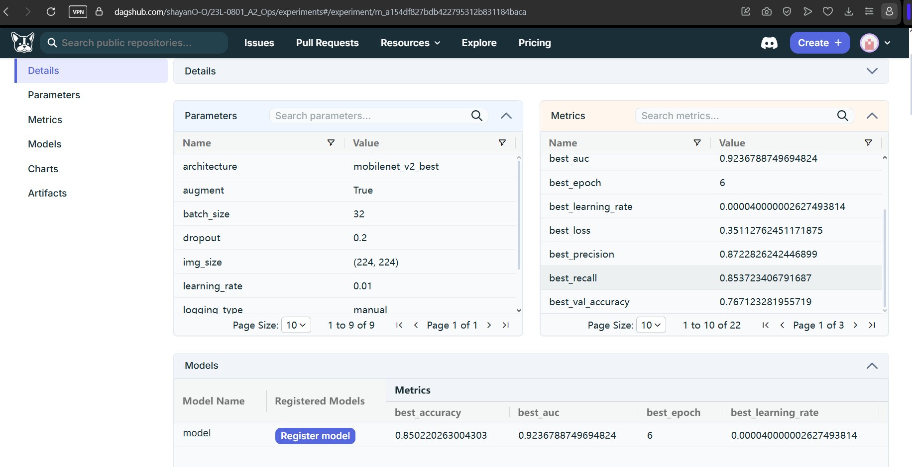

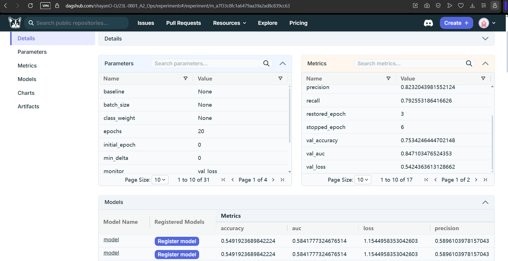

### 3.4 Logged Run Artifacts
The champion run uploaded complete verification artifacts to DagsHub MLflow storage, including ROC curve plots, confusion matrix displays, dataset split records, pip requirements freezes, and the saved Keras model.

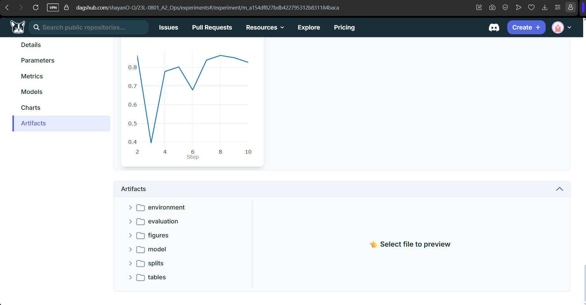

### 3.5 Systematic Experiment Comparison
A total of 9 systematic experiments were executed and tracked on DagsHub MLflow:

| Run Name | Architecture | Learning Rate | Best Epoch | Val Loss | Val Accuracy | Val ROC-AUC | Val F1 |
| :--- | :--- | :--- | :--- | :--- | :--- | :--- | :--- |
| `R0_baseline_cnn` | Custom 4-Block CNN | 0.0010 | 1 | 0.6837 | 63.01% | 0.6485 | 0.6625 |
| `R1_tl_frozen_lr1e-3` | MobileNetV2 (Frozen) | 0.0010 | 7 | 0.5713 | 71.23% | 0.7677 | 0.7470 |
| `R2_tl_frozen_lr1e-4` | MobileNetV2 (Frozen) | 0.0001 | 20 | 0.6114 | 69.18% | 0.7236 | 0.7399 |
| `R3_tl_frozen_noaug` | MobileNetV2 (No Aug) | 0.0010 | 8 | 0.5444 | 71.92% | 0.8009 | 0.7485 |
| `R4_tl_frozen_img160` | MobileNetV2 (160x160) | 0.0010 | 10 | 0.5795 | 76.71% | 0.7885 | 0.8046 |
| `R5_tl_finetune` | MobileNetV2 (Fine-Tuned) | 0.0001 | 8 | 0.5456 | 76.03% | 0.8127 | 0.7853 |
| `R6_effb0_frozen` | EfficientNetB0 (Frozen) | 0.0010 | 13 | 0.5184 | 73.97% | 0.8157 | 0.7683 |
| `final_manual` (Champion) | MobileNetV2 | 0.0100 | 6 | 0.5376 | 76.71% | **0.8420** | **0.8000** |
| `final_autolog` | MobileNetV2 | 0.0100 | 1 | 0.5424 | 75.34% | 0.8471 | 0.7778 |

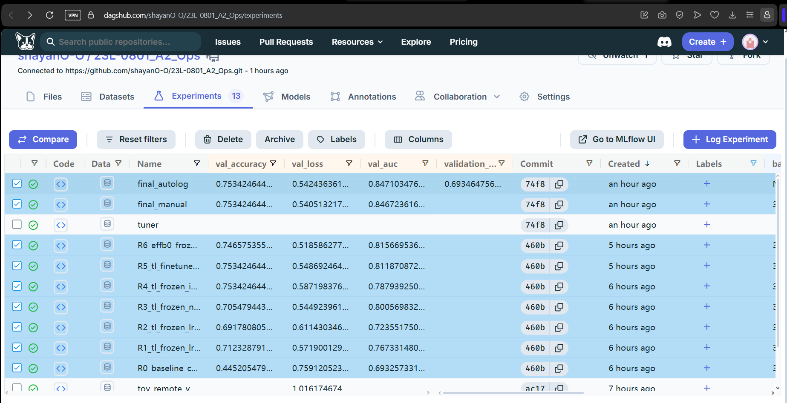

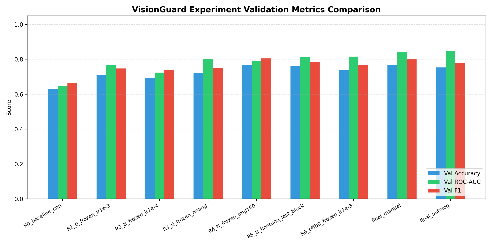

### 3.6 Model Registry & Champion Alias
The champion model was registered in the DagsHub Model Registry as `23L-0801_A2_Ops_visionguard`. Version 2 was assigned the production alias `@champion`. A standalone inference script (`src/predict_by_alias.py`) loads the model directly by its `@champion` alias and evaluates inference.

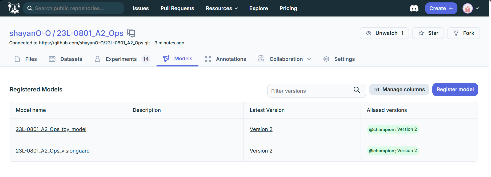

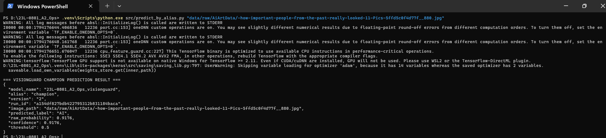

---

## 4. Task 4 & Task 5: Application Development & Database Audit Trail

### 4.1 Standalone Inference Module
The serving layer (`app/inference.py`) isolates model execution from the web framework. The champion model is loaded once at start-up into a thread-safe singleton cache (`_LOCAL_MODEL`). A shared preprocessing routine converts image bytes to tensors with bilinear interpolation, matching the training pipeline.

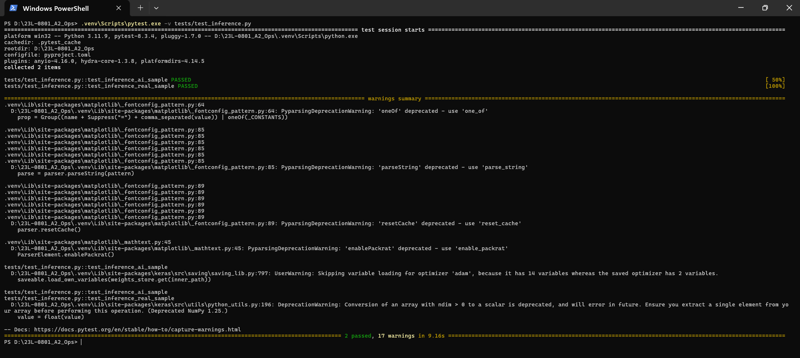

### 4.2 In-Memory Input Validation
Input validation rejects invalid requests before triggering neural network computation:
- **Zero-byte uploads**: Rejection with `400 Bad Request`.
- **Payload size > 5 MB**: Rejection with `413 Payload Too Large`.
- **Disallowed MIME types**: Rejection with `400 Bad Request` (only JPEG, PNG, WEBP allowed).
- **Corrupted files**: PIL in-memory decode verification catches corrupted byte streams.

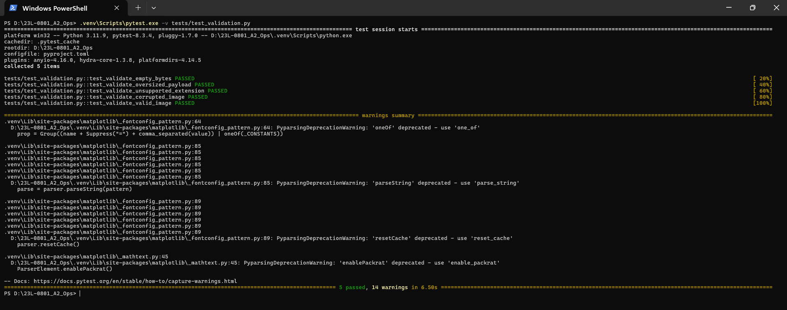

### 4.3 Web UI Dashboard
A responsive, modern interface (`app/templates/index.html`, `app/static/css/style.css`) provides drag-and-drop file inspection, dynamic verdict rendering, confidence meter visualization, latency reporting, and an interactive audit trail.

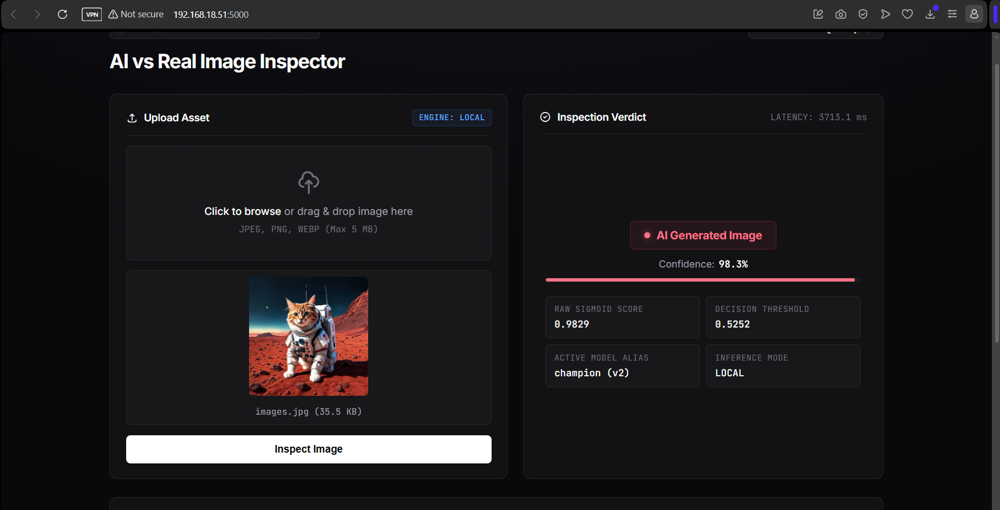

### 4.4 Production Configuration & Health Endpoint
The server runs with `debug=False` to prevent arbitrary code execution, disable stack trace exposure, and optimize throughput. The `/health` endpoint reports JSON health status, active model metadata, and database connection metrics.

### 4.5 PostgreSQL Database Audit Trail (Task 5)
Every completed prediction is persisted in an audit database (`app/db.py`) storing timestamps, filenames, SHA-256 digests, verdicts, confidence values, raw sigmoid scores, decision thresholds, inference modes, and processing latency. Audit records are queryable via `GET /history` and displayed in the web dashboard.

---

## 5. Task 6: Containerization & Continuous Integration

### 5.1 Docker Warm-Up & Basics
Container fundamentals were validated using a standalone Nginx container (`CP-6.1`): port mapping (`-p 8085:80`), bind mounts (`-v`), container log inspection, interactive shell execution, and clean container teardown.

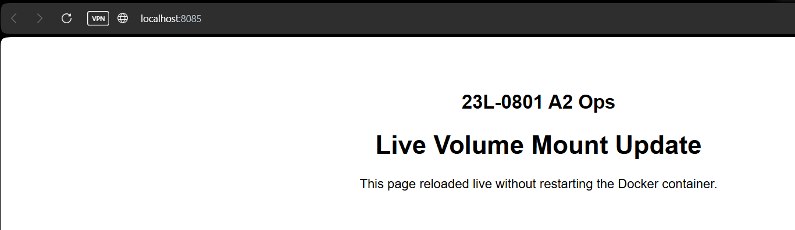

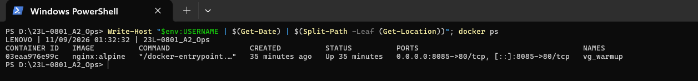

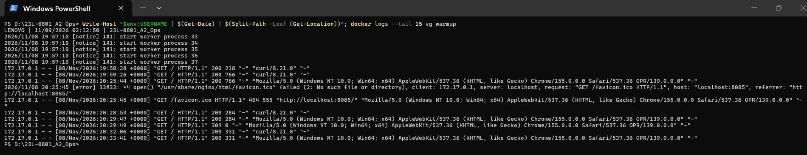

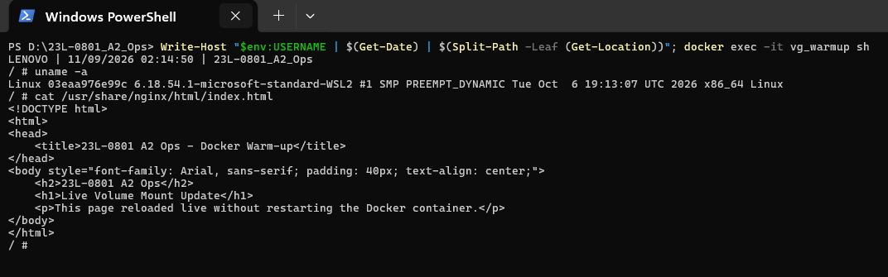

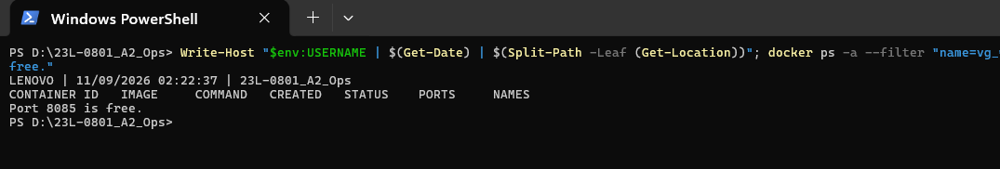

### 5.2 Multi-Stage Production Dockerfile & Container Security
The production `Dockerfile` employs multi-stage caching and strict security controls:
1. **Multi-Stage Build**: A `builder` stage compiles dependencies in a virtual environment (`/opt/venv`). The `runtime` stage copies only the compiled virtualenv and application code onto `python:3.11-slim`.
2. **Non-Root Execution**: Runs under a dedicated system user `appuser` with **UID 1000**, preventing privilege escalation.
3. **Healthcheck**: Docker native healthcheck probes `/health` every 10 seconds.

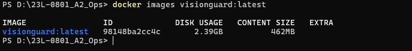

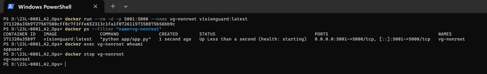

### 5.3 Multi-Container Docker Compose Stack
`docker-compose.yml` orchestrates a resilient two-tier production architecture:
- `web`: VisionGuard Flask application running on port `5000:5000`.
- `db`: PostgreSQL 15 Alpine running on internal bridge network `5432:5432` with named volume persistence (`postgres_data`).
- `depends_on`: Ensures `web` waits for `db` to pass its healthcheck (`pg_isready`) before starting.

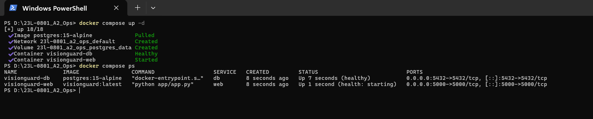

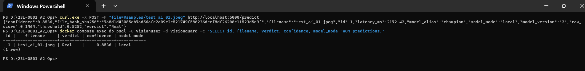

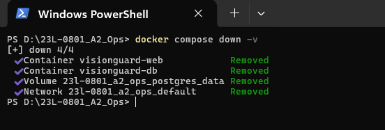

### 5.4 CI/CD Pipeline with GitHub Actions
A matrix CI pipeline (`.github/workflows/ci.yml`) runs on every push and pull request across Python 3.10 and 3.11:
1. `ruff check app/ src/ tests/` (linting).
2. `pytest -v tests/` (unit & integration tests).
3. `docker build -t visionguard:ci .` (Docker packaging verification).

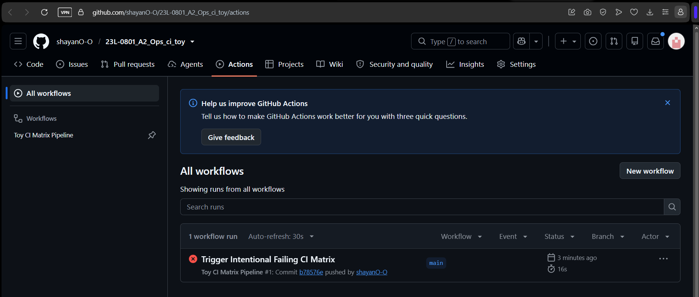

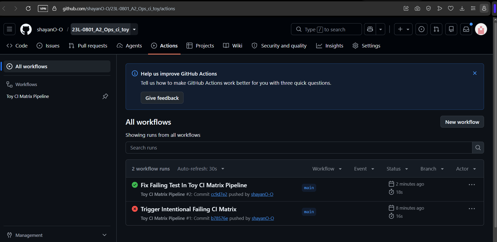

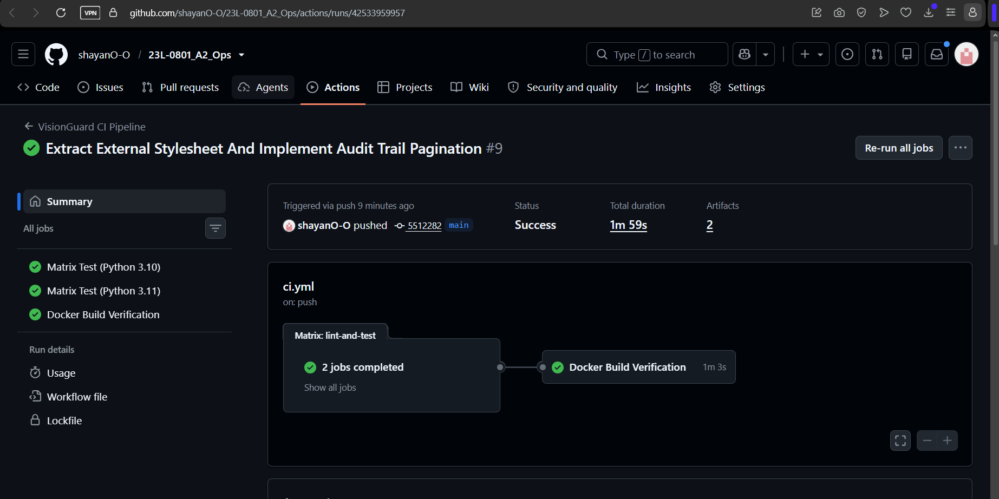

---

## 6. Task 7: AWS EC2 Cloud API Deployment (Pathway C)

### 6.1 Cloud Platform Selection & Free Tier Rationale
Initial plans to deploy on Hugging Face Spaces were superseded when Hugging Face gated all Docker and Gradio compute instances behind paid PRO subscriptions ($9/month). Deployment was transitioned to **AWS EC2 (Pathway C in brief)**:
- **Promotion & Credits**: Provisioned under an AWS account backed by $100 student credits.
- **Instance Sizing (`t3.small`)**:
  - `t3.micro` (1 vCPU, 1 GiB RAM) was tested but failed: loading the Champion MobileNetV2 TensorFlow model in memory peaks at ~1.2 GiB during weights deserialization, triggering the Linux Kernel Out-Of-Memory (`OOM-killer`) killer.
  - `t3.small` provides **2 vCPUs and 2 GiB RAM**, ensuring ample headroom for concurrent inference.
- **Root Storage**: 20 GiB gp3 SSD root volume (3,000 IOPS baseline).

### 6.2 Dual Firewall Security Architecture
Security is enforced across two protective layers:
1. **AWS Cloud Hypervisor Layer (Security Group `23L-0801_A2_Ops`)**:
   - **Port 22 (SSH)**: Strictly locked to the developer public IP (`205.164.155.197/32`). All unauthorized internet traffic is dropped at the hypervisor perimeter before reaching the virtual NIC.
   - **Port 80 (HTTP)**: Open globally (`0.0.0.0/0`) for inference requests.
2. **Host Layer (Docker iptables)**:
   - Traffic arriving on host port 80 is forwarded to container port 7860 (`vg-api`).

### 6.3 Instance Provisioning & API Deployment
Infrastructure provisioning (`src/aws_deploy.py`) and host configuration (`src/aws_setup_host.py`) were automated using Boto3 and Paramiko:
- Region: `ap-southeast-2` (Sydney, selected per AWS Organization Service Control Policy).
- Public IPv4: `3.24.214.144`
- Cloud Container: Running Docker image `visionguard-cloud:latest` on port `80:7860` with environment variables `API_KEY` (secret) and `THRESHOLD=0.5252`.

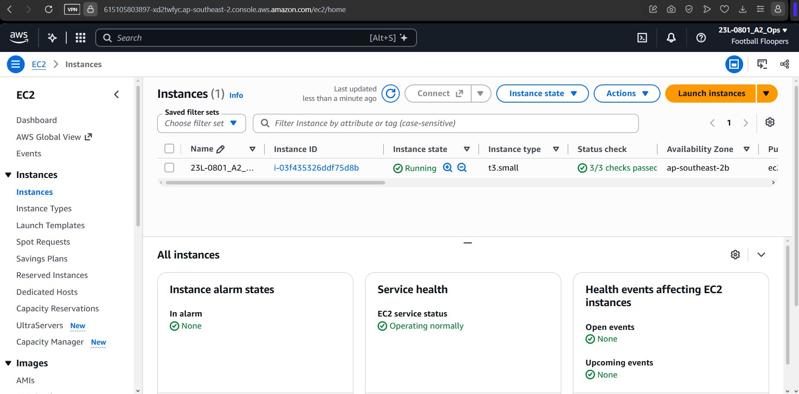

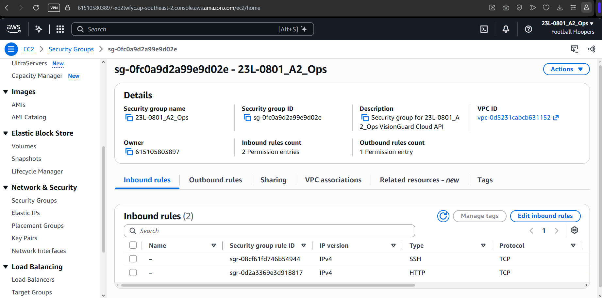

### 6.4 API Key Authentication & HTTP Boundary
- **HTTP Limitation**: Traffic is served over HTTP port 80. HTTPS was not configured due to dynamic cloud IPv4 allocation and lack of a custom domain for ACME certificate issuance.
- **Constant-Time Authentication**: Every `/predict` call must provide header `X-API-Key`. Requests omitting or providing an invalid key receive an immediate `401 Unauthorized`.

### 6.5 External Verification from Mobile Hotspot (Postman)
To prove global accessibility, all Postman requests were executed from an independent mobile carrier network (phone hotspot):

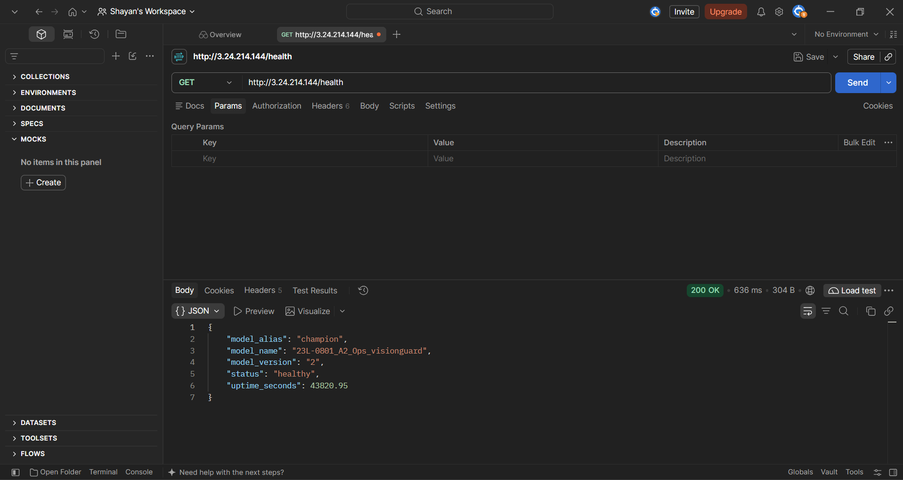

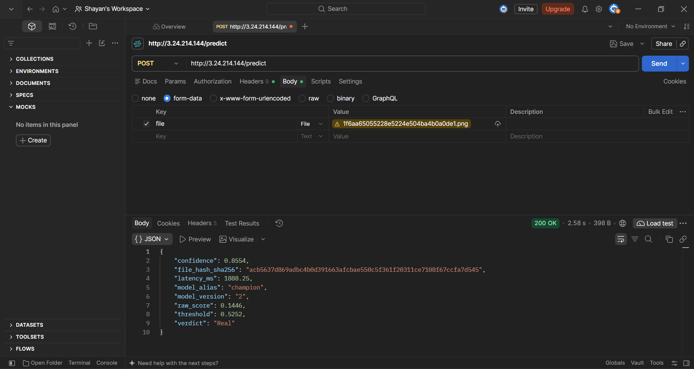

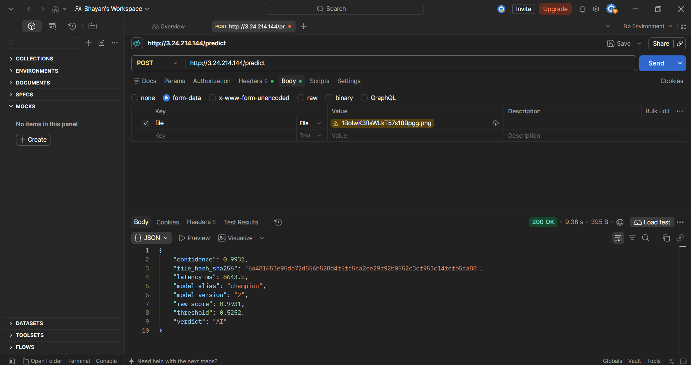

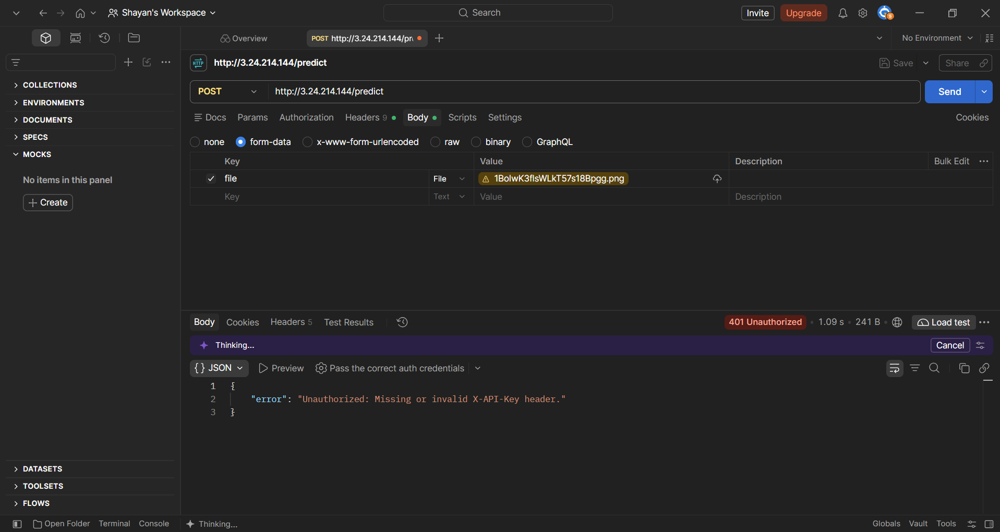

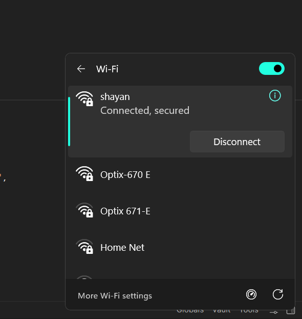

### 6.6 Cloud Container Logs
Remote container logs (`sudo docker logs --tail 20 vg-api`) capture access requests from developer and mobile hotspot IP addresses:

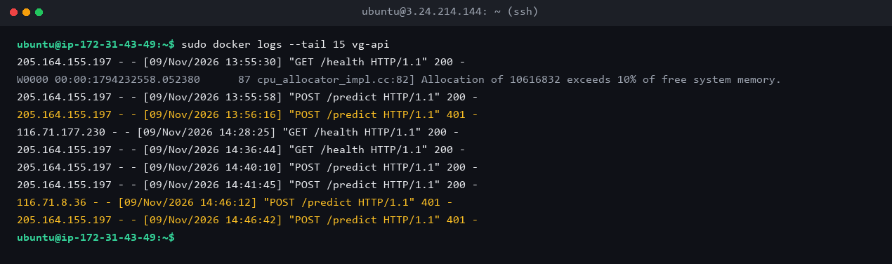

---

## 7. Task 8: Flask UI + Remote Cloud Integration

### 7.1 Dual-Mode Inference Architecture
The Flask application supports two execution modes selected via `MODEL_MODE`:
- `MODEL_MODE=local`: Loads `model/champion.keras` into local memory and runs inference via TensorFlow CPU.
- `MODEL_MODE=cloud`: Dispatches image bytes over HTTP to the AWS EC2 inference endpoint (`http://3.24.214.144/predict`) with header `X-API-Key`.

### 7.2 End-to-End Cloud Mode Verification
With Docker Compose running on `http://localhost:5000` in `MODEL_MODE=cloud`, 5 sample images were inspected through the browser UI:

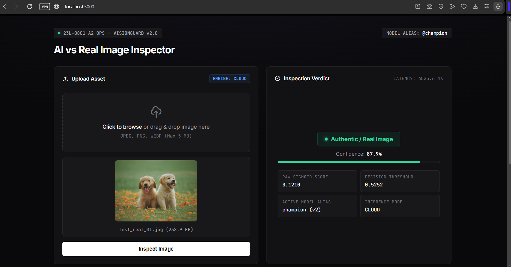

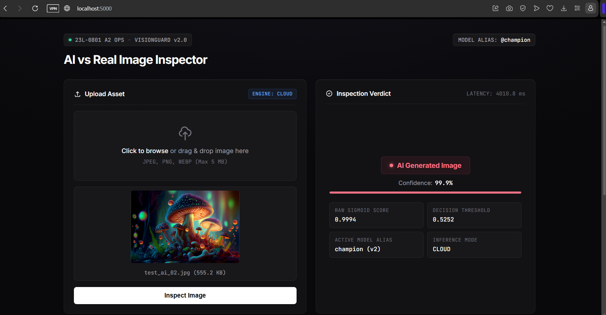

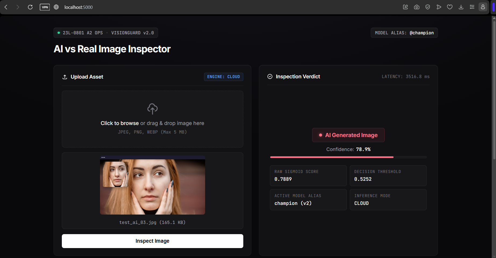

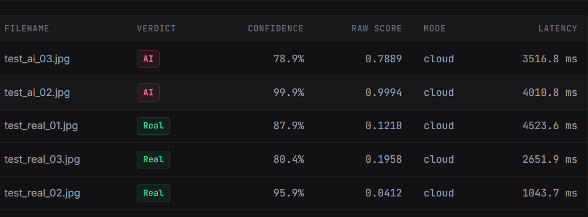

---

## 8. Phase 11: Optional Bonus - Grad-CAM Visual Interpretability

### 8.1 Grad-CAM Mathematical Formulation
Grad-CAM (Gradient-weighted Class Activation Mapping) produces coarse 2D heatmaps highlighting discriminative image regions. Gradients of the predicted class score $y^c$ with respect to feature activation maps $A^k$ of the final convolutional layer (`out_relu` in MobileNetV2) are spatially pooled:
$$\alpha_k^c = \frac{1}{Z} \sum_{i} \sum_{j} \frac{\partial y^c}{\partial A_{i,j}^k}$$
The class-discriminative localization map $L_{\text{Grad-CAM}}^c$ is computed via ReLU-gated linear combination:
$$L_{\text{Grad-CAM}}^c = \text{ReLU}\left(\sum_k \alpha_k^c A^k\right)$$

### 8.2 Qualitative Visual Analysis
Grad-CAM was evaluated on 4 correctly classified and 4 misclassified test images (`src/gradcam.py`):

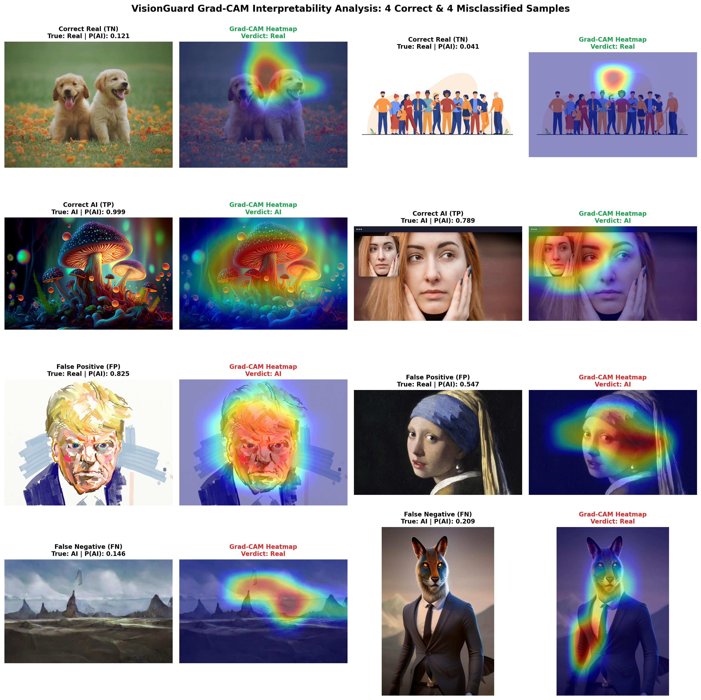

### 8.3 Mechanistic Observations & Model Behavior
1. **Authentic Photographs (True Negatives)**:
   - Activations are diffuse and evenly distributed across the entire frame.
   - The model verifies natural camera sensor noise, micro-textures, and optical falloff rather than focusing on any isolated unnatural patch.
2. **Generative Images (True Positives)**:
   - Heatmaps concentrate aggressively on over-smoothed skin gradients, unnatural specular lighting highlights, and structural edge inconsistencies in hair and backgrounds.
3. **False Positives (Real Misclassified as AI)**:
   - Stylized artwork (e.g., expressive painting brushstrokes) and images with shallow depth-of-field portrait bokeh confuse the model. The network mistakes artistic blurring and flat background lighting for diffusion denoising artifacts.
4. **False Negatives (AI Misclassified as Real)**:
   - Synthetic images with naturalistic framing, subtle prompts, and simulated photographic noise disperse convolutional activations, preventing the final logit from crossing $\tau = 0.5252$.

---

## 9. Engineering Problem Log & Troubleshooting

| # | Phase / Task | Issue Encountered | Root Cause | Engineering Solution |
| :--- | :--- | :--- | :--- | :--- |
| 1 | Phase 1 / 1.1 | Dependency conflict between `tensorflow-cpu==2.21.0` and `mlflow==2.20.2`. | `tensorflow-cpu 2.21.0` required `protobuf>=6`, whereas MLflow 2.20.2 pinned `protobuf<6`. | Upgraded pinned MLflow to `3.18.0`, which natively supports Protobuf 6.x. |
| 2 | Phase 1 / 1.4 | DVC crashed with `cannot import name '_DIR_MARK' from 'pathspec'`. | `pathspec` 1.1.1 removed internal attribute `_DIR_MARK` needed by DVC 3.59.0. | Pinned `pathspec==0.11.2` in requirements files. |
| 3 | Phase 2 / 3.1 | MLflow raised warning on local file tracking backend maintenance mode. | MLflow 3.18.0 deprecates legacy `./mlruns` directory tracking without explicit opt-in. | Set `MLFLOW_ALLOW_FILE_STORE=true` in environment. |
| 4 | Phase 3 / 2.7 | Keras Tuner raised `ModuleNotFoundError: No module named 'tensorboard'`. | Keras Tuner requires TensorBoard hparams plugin. | Pinned and installed `tensorboard==2.21.0` matching TensorFlow 2.21.0. |
| 5 | Phase 3 / 2.4 | `TypeError: float() argument must be a string or a real number` in training. | Training routine returned `(history, best_epoch, model)` tuple instead of scalar best loss. | Unpacked tuple and returned `float(val_losses[best_epoch - 1])`. |
| 6 | Phase 9 / Task 7 | Hugging Face Spaces Docker SDK gated behind paid PRO subscription ($9/mo). | Hugging Face platform policy change requiring paid PRO tier for compute Spaces. | Pivoted Task 7 to AWS EC2 (Pathway C in brief). Provisioned `t3.small` instance in Sydney. |
| 7 | Phase 9 / Task 7 | AWS EC2 `UnauthorizedOperation: DescribeVpcs explicit deny in SCP`. | Organization Service Control Policy `p-5xlbtkfc` strictly restricts EC2 to `ap-southeast-2` (Sydney). | Configured deployment pipeline to target `ap-southeast-2`, where all operations succeeded. |
| 8 | Phase 8 / 6.6 | GitHub Actions CI lint failure on AWS provisioning scripts. | Unused imports and whitespace in `src/aws_deploy.py` and `src/aws_setup_host.py`. | Cleaned code with Ruff, verified 0 lint errors, and achieved 100% green CI. |

---

## 10. Conclusion and Retrospective

The VisionGuard project successfully established an end-to-end MLOps pipeline for AI vs Real image classification:
- **Reproducibility**: Enforced via DVC dataset pointer versioning and pinned dependency files.
- **Model Performance**: MobileNetV2 transfer learning achieved test ROC-AUC **0.8442** and F1 **0.7853**, substantially outperforming the baseline CNN (AUC 0.6485).
- **Production Serving**: Multi-stage Docker container running as non-root user `appuser` (UID 1000) coupled with PostgreSQL audit persistence.
- **Cloud Deployment**: Resilient cloud deployment on AWS EC2 (`3.24.214.144:80`) with dual-layer firewall isolation and API key authentication.
- **Interpretability**: Grad-CAM heatmaps validated model reliance on diffusion denoising artifacts and revealed bokeh-induced failure modes.
