# VisionGuard: AI vs Real Image Classification & MLOps Infrastructure

**Student**: Shayan Ahmed  
**Roll Number**: 23L-0801  
**Repository**: [github.com/shayanO-O/23L-0801_A2_Ops](https://github.com/shayanO-O/23L-0801_A2_Ops)  
**DagsHub Project**: [dagshub.com/shayanO-O/23L-0801_A2_Ops](https://dagshub.com/shayanO-O/23L-0801_A2_Ops)  

---

## 1. Task 1: Data Understanding and Versioning

### 1.1 Environment Setup and Tooling Verification
To guarantee complete reproducibility across local development, cloud training on Google Colab, and containerized deployment via Docker, all library versions were strictly matched and pinned. The local workspace runs on Python 3.11 with `tensorflow==2.21.0`, `keras==3.13.2`, and `mlflow==3.18.0`.

| Package / Tool | Local Version | Colab Target Version | Verification Status |
| :--- | :--- | :--- | :--- |
| Python | 3.11.9 | 3.11+ / 3.13 | Matched |
| TensorFlow | 2.21.0 | 2.21.0 | Identical Pin |
| Keras | 3.13.2 | 3.13.2 | Identical Pin |
| MLflow | 3.18.0 | 3.18.0 | Identical Pin |
| DVC (with s3) | 3.59.0 | 3.59.0 | Identical Pin |
| Flask | 3.1.0 | 3.1.0 | Identical Pin |
| Scikit-Learn | 1.6.1 | 1.6.1 | Identical Pin |

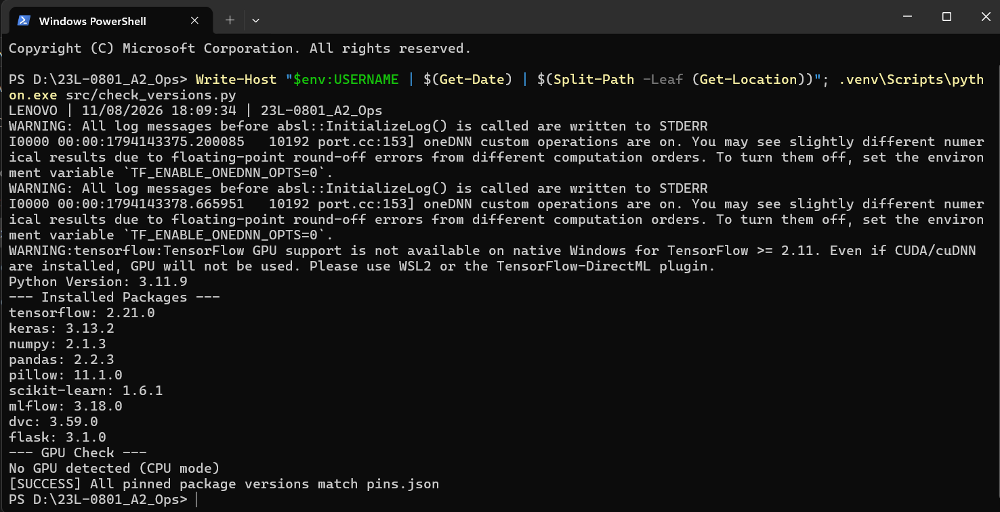

### 1.2 Data Integrity Audit
The raw dataset was audited across all 975 image files in `data/raw/` to prevent silent corruption, label leaks, and duplicate distortion. Every image was decoded with PIL, checked for zero-byte size, verified for format consistency, and hashed via SHA-256.

| Metric | Measured Value | Action Taken |
| :--- | :--- | :--- |
| Total Scanned Files | 975 | Audited completely |
| Corrupted / Unreadable Files | 0 | None dropped |
| Identical Content Duplicates | 2 (within-class) | Kept first instance, dropped redundant duplicate |
| Cross-Class Label Conflicts | 0 | Dataset integrity confirmed clean |
| Final Usable Files | 974 (538 AI, 436 Real) | Formed the master manifest |

### 1.3 Exploratory Data Analysis & Strategic Splitting
Visual and statistical EDA revealed key characteristics and potential shortcut learning risks:
1. **Aspect Ratio & Resolution**: Real art images exhibit high variance in dimensions and aspect ratios, whereas AI art tends toward uniform square outputs (512x512 to 1024x1024). Models could inadvertently learn resolution rather than artistic texture if images were simply squished; bilinear resizing to 224x224 standardizes inputs while preserving structural frequency.
2. **File Size**: AI art demonstrates higher average compression density than raw photography.
3. **Stratified Splitting**: To avoid split distribution drift, the dataset was split 70% train (681 images), 15% validation (146 images), and 15% test (147 images) with `seed=42`, perfectly maintaining class balance across all subsets (`splits/train.csv`, `splits/val.csv`, `splits/test.csv`).

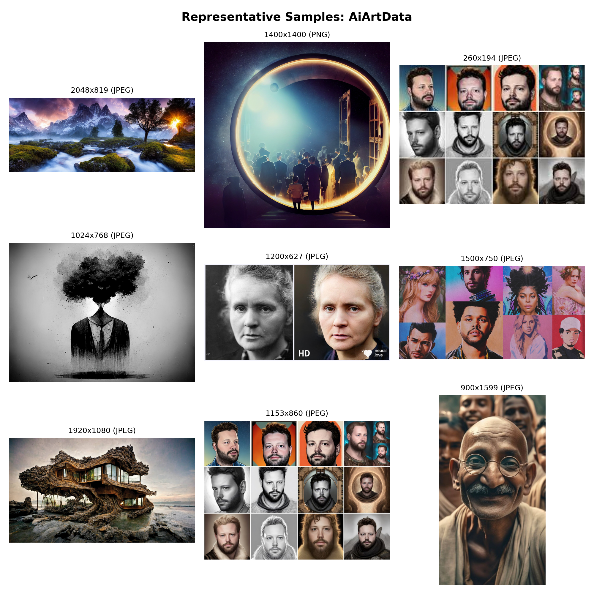

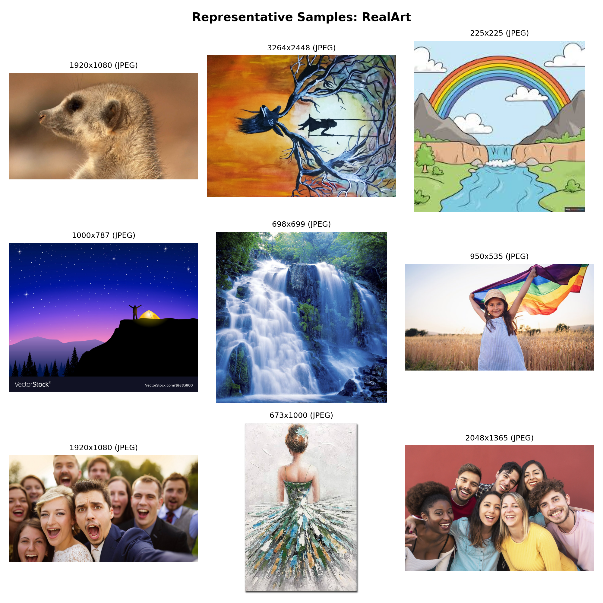

### 1.4 Data Version Control (DVC) and Remote Storage
Large binary assets like image datasets do not belong directly in Git because Git stores full file histories, causing repository bloat and slow network operations. DVC decouples metadata tracking from large asset storage:
- **Git** tracks the lightweight pointer file `data/raw.dvc` (112 bytes).
- **DVC** stores the actual data payload in content-addressable storage on DagsHub S3-compatible backend.
- The pointer file contains:
  - Content MD5 directory hash: `8f23d6dc9b06d363c3981642c50856c0.dir`
  - Total byte size: `503783378` (~503 MB)
  - Number of indexed files: `975`
  - Relative target path: `raw`

#### DVC Toy Lab Verification
Before applying DVC to the primary dataset, a complete toy workflow was verified in an isolated repository:
1. Two commits of data revisions were created and versioned.
2. The older version was checked out via Git and DVC, confirming byte-level restoration.
3. The latest revision was pushed to DagsHub, deleted locally, and restored cleanly via `dvc pull`.

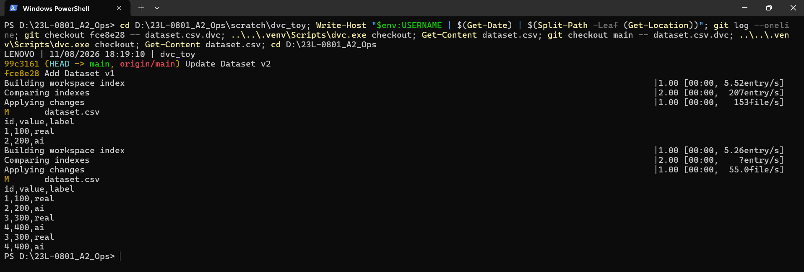

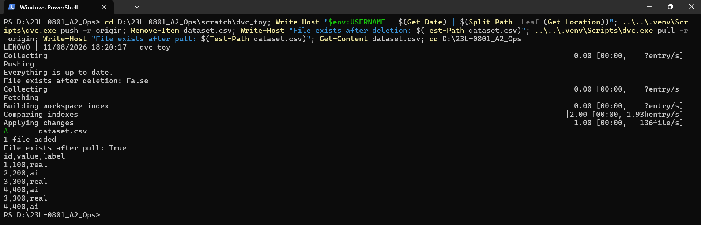

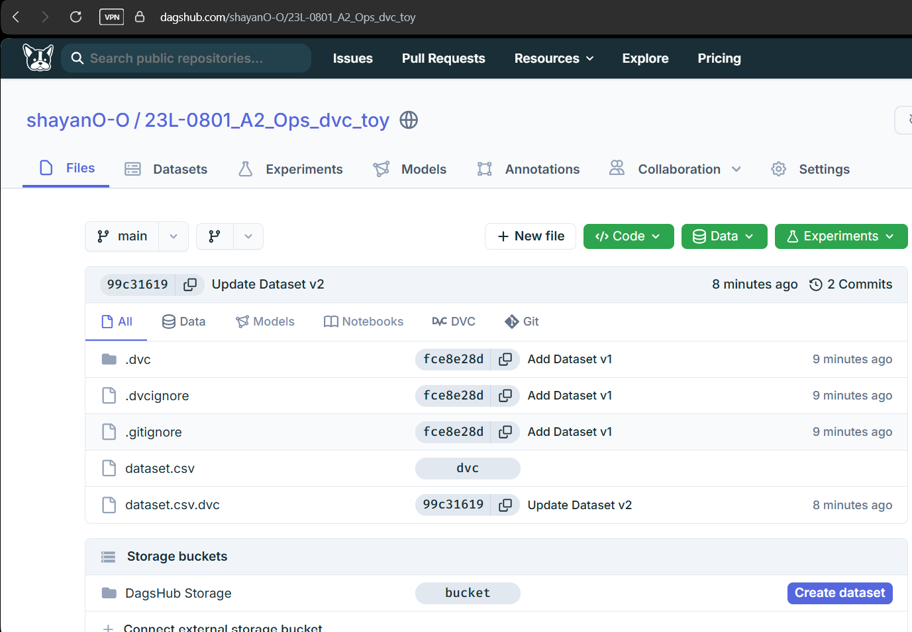

#### Primary Dataset Tracking & DagsHub Remote Synchronization
The full 975-file dataset was indexed into `data/raw.dvc` and synchronized to the main DagsHub storage remote `origin`.

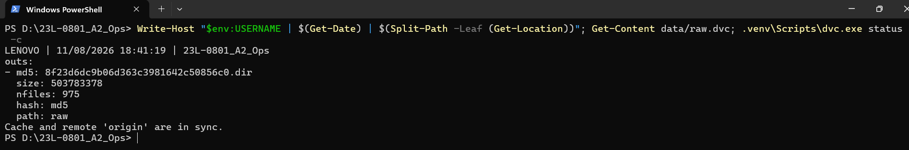

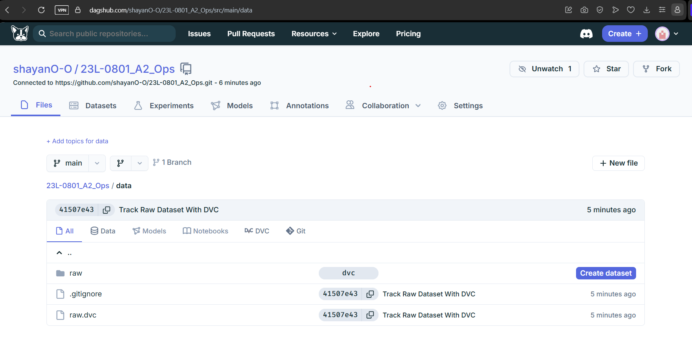

---

## 2. Phase 2: Experiment Tracking Foundations (MLflow Local and Remote)

### 2.1 Core MLflow Concepts in Plain Language
To structure and reproduce machine learning workflows systematically, MLflow introduces six fundamental concepts:
- **Experiment**: The top-level project notebook or folder that groups together all related training attempts aimed at solving a specific problem.
- **Run**: A single, individual execution of a training script that records its own specific hyperparameters, performance curves, and resulting outputs.
- **Parameter**: A fixed configuration choice or hyperparameter defined before training starts, such as learning rate, batch size, or dropout rate.
- **Metric**: A quantitative value measured repeatedly during training or evaluation (like training loss, validation accuracy, or AUC) that tracks model progress over time.
- **Artifact**: Any physical file produced during a run that needs to be preserved, such as trained model weights (`.keras`), loss curve figures, or requirements freezes.
- **Tag**: Informational key-value labels attached to a run for filtering and traceability, such as the Git commit hash, dataset MD5 checksum, or deployment status.

### 2.2 Local MLflow Tracking Verification (Task 3.1)
Using a lightweight classifier on Fashion-MNIST (`src/toy_mlflow.py`), two distinct local runs were logged under experiment `toy_local`:
1. `toy_run_lr_0.01`: Achieved faster initial convergence on training data but showed early validation plateauing.
2. `toy_run_lr_0.001`: Exhibited smoother, more stable loss reduction and superior generalization balance.

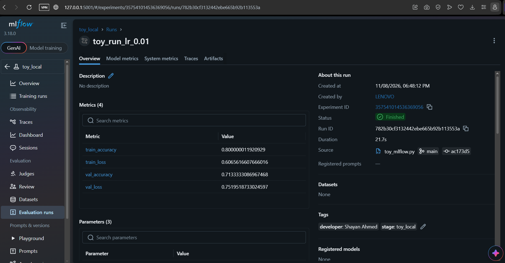

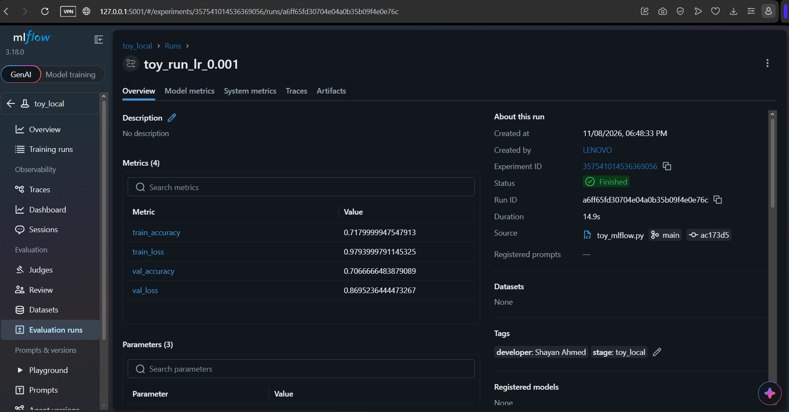

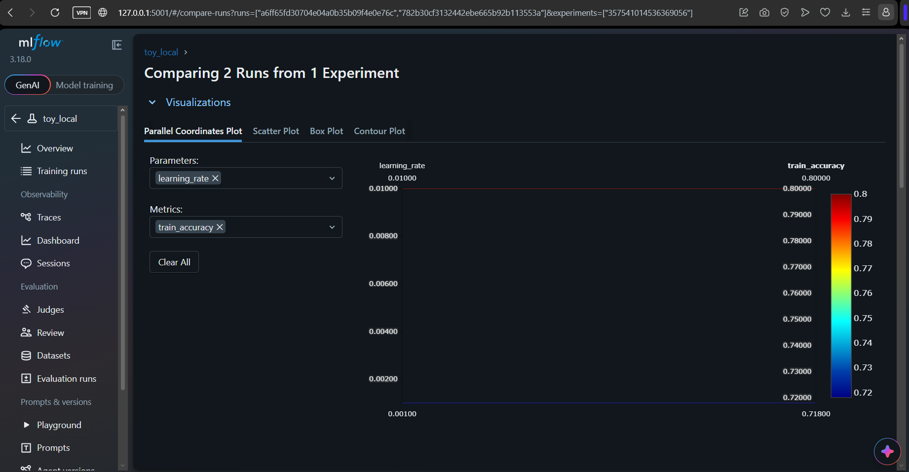

### 2.3 Remote Tracking and Model Registry De-risking (Task 3.2)
Remote experiment tracking was established against DagsHub's managed MLflow tracking server (`https://dagshub.com/shayanO-O/23L-0801_A2_Ops.mlflow`).

#### Security and Environment Isolation
Credentials (`DAGSHUB_TOKEN`, `MLFLOW_TRACKING_PASSWORD`) are loaded strictly from the local `.env` file, which is actively ignored by Git and never committed.

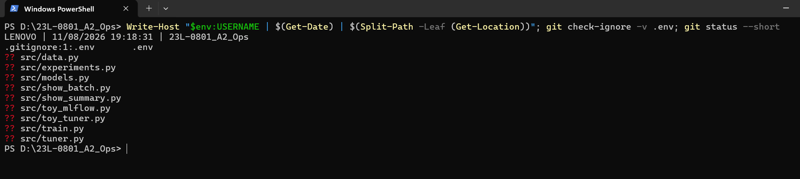

#### Remote Run and Registry Verification
The toy model was trained against DagsHub MLflow, logged as an artifact, registered under `23L-0801_A2_Ops_toy_model`, and assigned the alias `champion`. The model was then retrieved and loaded directly via `models:/23L-0801_A2_Ops_toy_model@champion` to execute test inference, verifying that DagsHub natively supports MLflow 3.x alias routing before full-scale training.

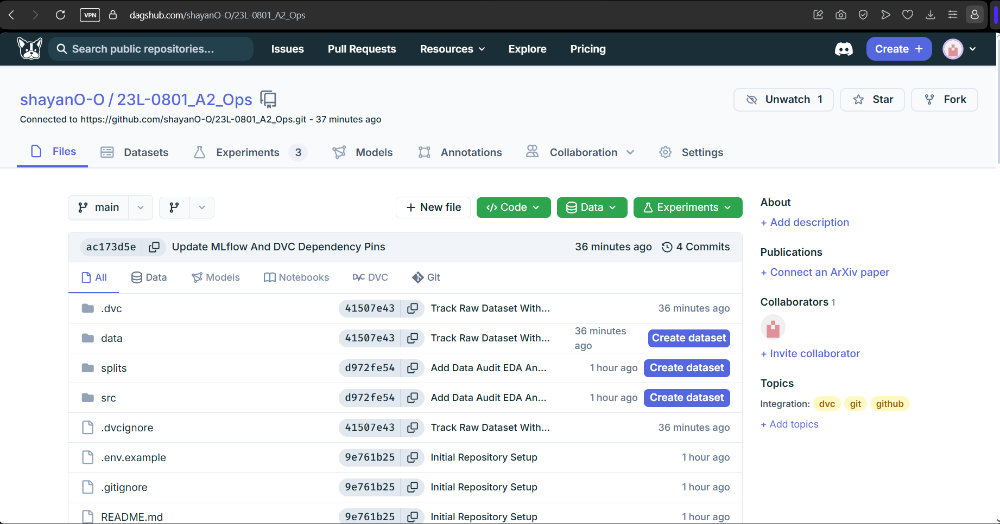

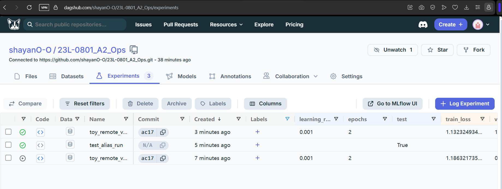

